  <picture>
    <source media="(prefers-color-scheme: dark) and (max-width: 600px)" srcset="assets/hero-m-dark.svg">
    <source media="(max-width: 600px)" srcset="assets/hero-m-light.svg">
    <source media="(prefers-color-scheme: dark)" srcset="assets/hero-dark.svg">
    
  </picture>

  <a href="https://github.com/Sepd0x/cs2-ip-changer/releases/latest"><picture><source media="(prefers-color-scheme: dark)" srcset="assets/btn-download-dark.svg"></picture></a>

  <a href="https://github.com/Sepd0x/cs2-ip-changer">
    <picture>
      <source media="(prefers-color-scheme: dark) and (max-width: 600px)" srcset="assets/cs2-m-dark.svg">
      <source media="(max-width: 600px)" srcset="assets/cs2-m-light.svg">
      <source media="(prefers-color-scheme: dark)" srcset="assets/cs2-dark.svg">
      
    </picture>
  </a>

  <a href="https://sepd0x.github.io/marco-polo/">
    <picture>
      <source media="(prefers-color-scheme: dark) and (max-width: 600px)" srcset="assets/marco-polo-m-dark.svg">
      <source media="(max-width: 600px)" srcset="assets/marco-polo-m-light.svg">
      <source media="(prefers-color-scheme: dark)" srcset="assets/marco-polo-dark.svg">
      
    </picture>
  </a>

  <a href="https://tryhackme.com/p/Sepd">
    <picture>
      <source media="(prefers-color-scheme: dark) and (max-width: 600px)" srcset="assets/thm-m-dark.svg">
      <source media="(max-width: 600px)" srcset="assets/thm-m-light.svg">
      <source media="(prefers-color-scheme: dark)" srcset="assets/thm-dark.svg">
      
    </picture>
  </a>

